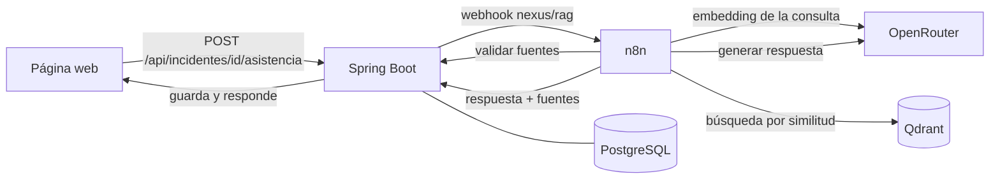
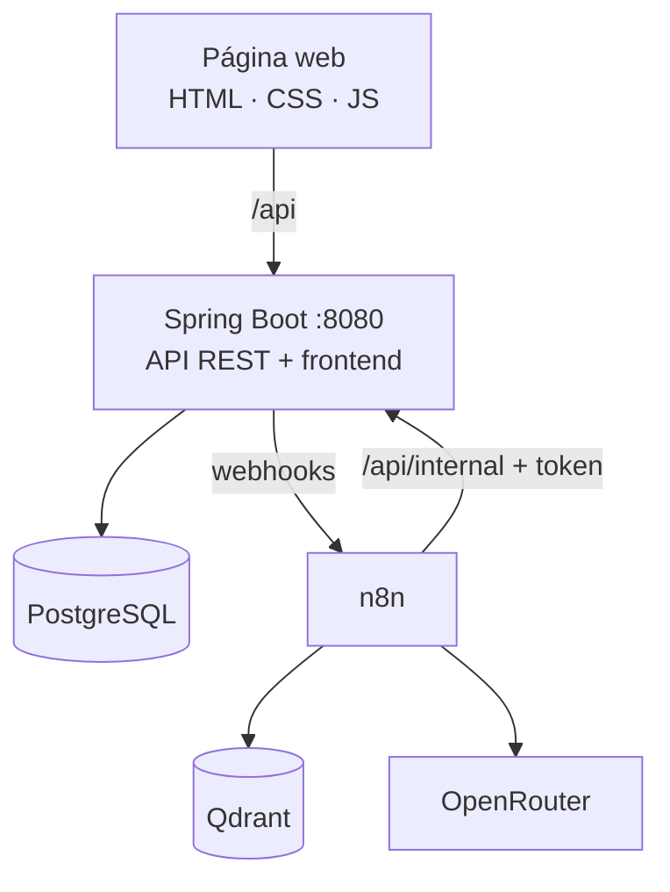

# NEXUS Support

## 1. Descripción del sistema

En una mesa de ayuda de TI los mismos problemas se repiten (sin internet, aplicaciones que no abren, cuentas bloqueadas),
pero la solución suele depender de la experiencia de cada técnico y el historial de incidentes rara vez se analiza.

**NEXUS Support** es una aplicación web que reúne en un solo lugar:

- el **registro y seguimiento de incidentes** tecnológicos;
- una **base de conocimiento** con artículos de solución revisados;
- un **asistente inteligente** que propone una solución a partir de esos artículos, citando sus fuentes, y que avisa
  cuando no tiene información suficiente en lugar de inventar una respuesta;
- un **dashboard analítico** con indicadores calculados sobre los incidentes almacenados.

El objetivo es que el técnico resuelva más rápido con soluciones ya verificadas y que el equipo pueda ver qué problemas
son más frecuentes y cuánto tarda en resolverlos.

## 2. Funciones de la página

Para entrar hay que **iniciar sesión** (`login.html`) con correo y contraseña. El menú superior muestra solo las páginas
del perfil de la cuenta, el nombre del usuario y los botones *Contraseña* (cambiar la propia) y *Salir*.

| Perfil | Puede |
|---|---|
| **Solicitante** | Registrar incidentes y ver solo los suyos (*Mis incidentes*): datos, estado y SLA. No elige técnico ni estado. |
| **Técnico** | Todo lo de incidentes (ver todos, editar, reasignar, cambiar estado), asistente, calificaciones, Dashboard, Historial IA y consultar la base de conocimiento. |
| **Administrador** | Lo mismo que el técnico, más modificar la base de conocimiento, administrar cuentas (página *Usuarios*) y abrir Swagger. |

Los permisos se comprueban en el servidor en cada petición; ocultar botones en la página es solo una ayuda visual.

### Dashboard (página de inicio)

- **Indicadores:** total de incidentes y pendientes, tasa de resolución, tiempo promedio de resolución (con la mediana),
  cumplimiento del SLA según la prioridad, categoría más recurrente y número de consultas al asistente con sus calificaciones.
- **Gráficos:** evolución de incidentes registrados y resueltos, incidentes por categoría, tiempo promedio de resolución
  por categoría (horas), incidentes por prioridad, incidentes por estado, problemas más recurrentes y uso del asistente inteligente.
- **Filtros:** rango de fechas (Desde/Hasta), categoría, prioridad y tendencia **semanal** o **diaria**
  (botones *Aplicar* y *Limpiar*).
- **Ver datos:** cada gráfico permite ver la tabla con los valores que lo forman.
- **SLA operativo:** de los incidentes no finalizados (Abierto o En progreso), cuántos están **en plazo**, **por vencer**
  y **vencidos** en este momento, y la lista de los más urgentes con enlace a su detalle.

Todas las cifras se calculan con consultas SQL sobre los datos guardados en PostgreSQL.

**Regla de SLA.** Vencimiento = fecha de creación + horas de SLA de la prioridad (Baja 72 h, Media 24 h, Alta 8 h,
Crítica 4 h). Un incidente no finalizado está *vencido* si ya pasó el vencimiento y *por vencer* si le queda el 25 % del
plazo o menos. Un incidente finalizado muestra *SLA cumplido* o *SLA incumplido* según su fecha de resolución. No hay
escalamiento automático ni notificaciones.

### Incidentes

- **Listado** paginado con filtros por texto (título o descripción), categoría, prioridad, estado y rango de fechas.
- **Columna SLA** en el listado (en plazo, por vencer, vencido, cumplido o incumplido).
- **Nuevo incidente:** formulario con título, descripción, categoría, prioridad, **técnico responsable** y, opcionalmente,
  el **solicitante** (quien reporta).
- **Detalle:** al hacer clic en un incidente se muestra su información, el solicitante, el bloque de SLA (horas, vencimiento,
  horas restantes o de retraso) y se puede **cambiar el estado** (Abierto, En progreso, Resuelto, Cerrado) con el botón
  *Actualizar*. Al pasar a Resuelto o Cerrado se registra la fecha de resolución; si se reabre, se elimina.
- **Editar / reasignar:** modifica título, descripción, categoría, prioridad, técnico responsable y solicitante.
  Solo se puede asignar a técnicos activos (si el responsable actual quedó inactivo se conserva, pero no se le asignan
  incidentes nuevos). Cambiar la prioridad recalcula el SLA desde la fecha de creación.
- **Asistente inteligente:** campo de consulta (si se deja vacío se usa la descripción del incidente) y botón
  *Solicitar asistencia*.
- **Historial de asistencias** del incidente, con cada respuesta, sus fuentes y su calificación.

### Base de conocimiento

- **Listado** de artículos con filtros por estado (activos/inactivos) y categoría. Para cada artículo se ve si está
  activo, si está verificado y si es **fuente RAG** (puede ser usado por el asistente).
- **Activar/desactivar** y **verificar** con las casillas de la tabla.
- **Nuevo artículo** y **Editar:** título, categoría, descripción del problema, síntomas, causa, procedimiento de
  solución y verificado.
- **Sincronizar embeddings:** ejecuta manualmente la indexación (normalmente es automática).
- Crear, editar, activar/verificar y sincronizar solo están disponibles para administradores; los técnicos ven la
  base de conocimiento en modo lectura.
- **Calidad de la base de conocimiento**, separada en:
  - *Datos observados:* artículos más útiles (veces citados como fuente, similitud media y calificación promedio de las
    respuestas que los usaron, e indicación de si hoy siguen siendo fuente válida), consultas que terminaron sin fuentes y
    cobertura por categoría (artículos válidos, consultas, respondidas, sin fuentes y mal calificadas).
  - *Recomendaciones:* sugerencias generadas por reglas fijas sobre esos datos (categoría sin artículos válidos,
    consultas sin fuentes, respuestas calificadas con 2 o menos, artículo con promedio ≤ 2,5 en al menos 2 calificaciones).
    No son verificadas por una persona.

Solo los artículos **activos y verificados** se usan como fuentes del asistente.

### Historial IA

- Todas las consultas al asistente, paginadas y filtrables por estado: *Pendiente*, *Respondida*, *Sin resultados* o *Error*.
- Cada consulta muestra el incidente al que pertenece, la pregunta, la fecha, el umbral usado, la respuesta, los pasos,
  las fuentes con su similitud y la calificación.

### Calificaciones

Las respuestas (*Respondida* o *Sin resultados*) se califican de 1 a 5 estrellas, con un comentario opcional,
desde el detalle del incidente o desde el Historial IA.

### Usuarios (solo administradores)

- Listado de cuentas con nombre, correo, área, perfil, estado y si tienen contraseña.
- **Nueva cuenta** (contraseña inicial opcional), **Editar** (nombre, correo, área, perfil y estado) y
  **Contraseña** (asignar o restablecer).
- Reglas: una cuenta sin contraseña no puede entrar; solo las cuentas *Técnico* activas reciben incidentes; un
  administrador no puede cambiar su propio perfil, correo ni estado; siempre debe quedar un administrador activo.
  Cambiar perfil, correo, estado o contraseña de una cuenta cierra sus sesiones abiertas.
- Los 10 usuarios de los datos iniciales son técnicos **sin contraseña**: el administrador debe asignársela para que
  puedan entrar.

### Incidentes registrados por un solicitante

El incidente nace *Abierto*, se asigna al técnico activo con menos incidentes no finalizados (desempate por id) y queda
ligado a la cuenta del solicitante, cuyo nombre no se puede editar después.

## 3. Recorrido de uso

0. **Entrar:** abrir http://localhost:8080, que lleva a la página de inicio de sesión.
1. **Registrar un incidente:** *Incidentes* → *+ Nuevo incidente* → completar el formulario → *Registrar*.
2. **Consultar incidentes:** usar los filtros del listado y hacer clic en una fila para abrir el detalle.
3. **Solicitar asistencia:** en el detalle, escribir la consulta (o dejarla vacía) → *Solicitar asistencia*.
   El resultado aparece en el historial del incidente:
   - *Respondida*: explicación, pasos y artículos usados;
   - *Sin resultados*: ningún artículo válido fue suficientemente parecido;
   - *Error*: indica en qué etapa falló (por ejemplo, el servicio de embeddings).
4. **Revisar las fuentes:** cada fuente muestra el número y título del artículo y su similitud (0 a 1). El número enlaza
   al artículo en la *Base de conocimiento*.
5. **Calificar:** pulsar las estrellas de la respuesta y, si se desea, escribir un comentario.
6. **Seguir el estado:** cambiar el estado del incidente a *En progreso*, *Resuelto* o *Cerrado*; con *Editar / reasignar*
   se corrigen los datos o se cambia el técnico responsable.
7. **Consultar tendencias:** en el *Dashboard*, elegir fechas, categoría, prioridad y tendencia semanal o diaria → *Aplicar*.
   La sección *SLA operativo* muestra qué incidentes abiertos están vencidos o por vencer.
8. **Mejorar la base de conocimiento:** en *Base de conocimiento*, revisar la sección de calidad (consultas sin fuentes,
   cobertura por categoría y recomendaciones); un administrador crea o verifica los artículos que falten.

## 4. Cómo funciona la asistencia inteligente



1. La página envía la solicitud a Spring Boot, que registra la consulta como **PENDIENTE** en PostgreSQL y llama al flujo RAG de n8n.
2. n8n convierte la consulta en un vector (*embedding*) con OpenRouter.
3. Busca en Qdrant los artículos más parecidos (entre 3 y 5 candidatos), solo entre los marcados como fuente válida.
4. Descarta los candidatos por debajo del **umbral de similitud** (0.45 por defecto).
5. Confirma con Spring Boot (`/api/internal/articulos/validar`, protegido con token) que siguen **activos y verificados**
   en PostgreSQL. El texto que recibe el modelo sale de PostgreSQL, no de Qdrant.
6. **Si no quedan fuentes suficientes**, no se llama al modelo generativo: la consulta termina en **SIN_RESULTADOS** con
   un mensaje que lo indica.
7. Si hay fuentes, OpenRouter redacta la respuesta usando solo esos artículos (temperatura baja, salida JSON).
8. Spring Boot vuelve a validar las fuentes, guarda respuesta, pasos, fuentes y similitudes y deja la consulta en
   **RESPONDIDA**. Cualquier fallo (validación, embeddings, Qdrant, generación o tiempo de espera) la deja en **ERROR**.

La validez de las fuentes se comprueba tres veces: filtro en Qdrant, validación en n8n contra PostgreSQL y revalidación
en Spring Boot. Cada consulta guarda el umbral con el que se ejecutó.

**Indexación.** Al arrancar Spring Boot y cada vez que se crea, edita, activa o desactiva un artículo, se ejecuta el flujo
de indexación de n8n. Este lee los artículos desde Spring Boot, compara un hash del texto con lo guardado en Qdrant,
genera embeddings solo de lo nuevo o modificado y elimina de Qdrant los artículos inactivos o no verificados.

**Umbral de similitud.** `RAG_UMBRAL_SIMILITUD=0.45` y `RAG_TOP_K=5`. Con `text-embedding-3-small`, textos en español
sobre el mismo problema suelen dar similitudes de 0.5 a 0.7, y los de temas distintos quedan por debajo de 0.35; con 0.45
se prefiere informar "sin resultados" antes que dar una recomendación sin respaldo. Es un valor de partida: la calibración
con datos reales (`CalibracionUmbralIT`) aún no se ha ejecutado (ver sección 7).

## 5. Tecnologías y arquitectura

| Componente | Tecnología | Responsabilidad |
|---|---|---|
| Frontend | HTML, CSS, JavaScript, Chart.js | Páginas, formularios y gráficos; solo consume la API de Spring Boot |
| Backend | Java 21, Spring Boot 3.5 | API REST, validaciones, reglas de negocio, analítica SQL; sirve el frontend |
| Base relacional | PostgreSQL 16+ | Incidentes, catálogos, artículos, consultas, respuestas, fuentes y calificaciones |
| Automatización | n8n | Flujos de indexación y de asistencia RAG |
| Base vectorial | Qdrant | Embeddings de los artículos válidos (colección `articulos_conocimiento`) |
| Modelos de IA | OpenRouter | Embeddings (`openai/text-embedding-3-small`) y generación (`openai/gpt-4o-mini`) |



El navegador solo habla con Spring Boot; n8n, Qdrant y OpenRouter nunca se llaman desde la página. Las claves viven en
`.env` (no versionado) y en las credenciales de n8n.

### API principal

Perfiles: **S** = solicitante, **T** = técnico, **A** = administrador. Sin sesión, la API responde 401; sin permiso, 403.
Las peticiones que modifican datos deben enviar el token CSRF (cookie `XSRF-TOKEN` → cabecera `X-XSRF-TOKEN`).

| Método | Ruta | Perfiles | Descripción |
|---|---|---|---|
| GET | `/api/auth/sesion` | Público | Cuenta de la sesión actual; entrega la cookie CSRF |
| POST | `/api/auth/login`, `/api/auth/logout` | Público / sesión | Iniciar / cerrar sesión |
| PUT | `/api/auth/clave` | S T A | Cambiar la contraseña propia |
| GET/POST | `/api/usuarios` | A | Listar / crear cuentas |
| PUT | `/api/usuarios/{id}`, `/api/usuarios/{id}/clave` | A | Editar cuenta / asignar contraseña |
| GET | `/api/catalogos` | S T A | Categorías, prioridades, estados y técnicos asignables |
| GET/POST | `/api/incidentes` | S T A | Listar con filtros (el solicitante solo ve los suyos) / registrar |
| GET | `/api/incidentes/{id}` | S T A | Detalle con `sla` (el solicitante solo los suyos) |
| PUT | `/api/incidentes/{id}` | T A | Editar y reasignar |
| PATCH | `/api/incidentes/{id}/estado` | T A | Cambiar estado |
| POST | `/api/incidentes/{id}/asistencia` | T A | Solicitar asistencia RAG |
| GET | `/api/incidentes/{id}/consultas` | T A | Historial de asistencias del incidente |
| GET | `/api/consultas`, `/api/consultas/{id}` | T A | Historial global (filtro por estado) / detalle |
| GET/PUT | `/api/respuestas/{id}/calificacion` | T A | Ver / guardar calificación (1 a 5) |
| GET | `/api/articulos`, `/api/articulos/{id}` | T A | Listar / detalle de artículos |
| POST/PUT/PATCH | `/api/articulos`, `/api/articulos/{id}`, `/api/articulos/{id}/estado` | A | Crear / editar / activar y verificar |
| POST | `/api/articulos/reindexar` | A | Ejecutar la indexación (`?forzar=true` revectoriza todo) |
| GET | `/api/analitica/dashboard`, `/api/analitica/sla`, `/api/analitica/conocimiento` | T A | Dashboard, SLA operativo y calidad de la base de conocimiento |
| GET | `/api/analitica/{resumen,categorias,prioridades,estados,tendencia,recurrentes,asistencia}` | T A | Indicadores individuales |
| GET/POST | `/api/internal/articulos`, `/api/internal/articulos/validar` | n8n | Sin sesión; exigen `X-Internal-Token` |

Documentación interactiva (solo administradores con sesión iniciada): http://localhost:8080/swagger-ui.html

## 6. Instalación y configuración

El proyecto **no se inicia con Docker**: Spring Boot se ejecuta con Maven y se conecta a PostgreSQL, n8n y Qdrant ya en
funcionamiento, configurados en `.env`.

### Requisitos

- Java 21 y Maven 3.9
- PostgreSQL 16 o superior
- Una instancia de n8n con el workflow [`n8n/workflows/nexus-support.json`](n8n/workflows/nexus-support.json) importado y publicado
- Qdrant accesible desde n8n
- Una API key de [OpenRouter](https://openrouter.ai/keys) con saldo, registrada como credencial en n8n

### Variables de entorno (`.env`)

```bash
cp .env.example .env
```

| Variable | Uso |
|---|---|
| `DB_URL`, `DB_USER`, `DB_PASSWORD` | Conexión a PostgreSQL (por defecto `jdbc:postgresql://localhost:5432/nexus_support`, usuario `nexus`) |
| `N8N_WEBHOOK_BASE_URL` | URL base de los webhooks de n8n (por ejemplo `http://localhost:5678/webhook`) |
| `INTERNAL_API_TOKEN` | Token de los endpoints internos; debe coincidir con la credencial "NEXUS - Token interno" de n8n |
| `NEXUS_ADMIN_CORREO`, `NEXUS_ADMIN_CLAVE` | Primera cuenta de administración (contraseña de mínimo 8 caracteres). Solo se usan si no existe ningún administrador activo con contraseña; después no modifican nada |
| `RAG_UMBRAL_SIMILITUD`, `RAG_TOP_K`, `RAG_MIN_RESULTADOS`, `RAG_TIMEOUT_SEGUNDOS` | Parámetros del asistente |
| `RAG_PERMITIR_SIMULACION_FALLOS` | Habilita `?simularFalloEmbeddings=true` (prueba 8); `false` en producción |
| `OPENROUTER_API_KEY`, `OPENROUTER_BASE_URL`, `EMBEDDING_MODEL` | Solo para la calibración del umbral |

### Puesta en marcha

1. **Crear el usuario y la base** (una vez, con un superusuario de PostgreSQL):

   ```bash
   psql -U postgres -v clave=EL_VALOR_DE_DB_PASSWORD -f database/00-crear-base.sql
   ```

2. **Configurar n8n** (una vez):
   - Crear las credenciales **OpenRouter** (tipo *OpenRouter API*) y **NEXUS - Token interno** (tipo *Header Auth*,
     nombre `X-Internal-Token`, valor = `INTERNAL_API_TOKEN`).
   - *Import from File* de `n8n/workflows/nexus-support.json` (un solo workflow con las dos ramas: indexación y asistencia RAG).
   - Revisar el nodo **Configuración** (URL del backend y de Qdrant vistas desde n8n; si n8n corre en
     un contenedor, usar `host.docker.internal`) y asignar las credenciales en los nodos HTTP que las pidan.
   - Pulsar **Publish**.

3. **Iniciar la aplicación:**

   ```bash
   cd backend
   mvn spring-boot:run
   ```

   Spring Boot lee `../.env`. Si la base está vacía (no existe la tabla `incidente`), carga `database/init/01..04`
   automáticamente. En cada arranque aplica además `database/init/05-mejoras.sql`, que es idempotente
   (`ADD COLUMN IF NOT EXISTS`, `DROP CONSTRAINT IF EXISTS`), para actualizar bases ya creadas: solicitante, perfil y
   contraseña de las cuentas. Luego invoca la indexación.

4. **Primer inicio de sesión:** si no hay ningún administrador con contraseña, al arrancar se crea la cuenta
   `NEXUS_ADMIN_CORREO` con la contraseña `NEXUS_ADMIN_CLAVE` (en el registro aparece «Cuenta de administración inicial
   lista»). Entrar con ella, cambiar la contraseña con el botón *Contraseña* y, en *Usuarios*, asignar contraseña a los
   técnicos y crear las cuentas de los solicitantes.

### Acceso y seguridad

- **Inicio de sesión** con Spring Security: cuentas en la tabla `usuario` (correo + contraseña con hash **BCrypt**),
  sesión HTTP con cookie y protección **CSRF** en todas las escrituras. Al iniciar sesión se renueva el identificador de
  sesión. El mensaje de error no distingue entre correo inexistente, contraseña errónea o cuenta inactiva.
- **Autorización por perfil** en el servidor (reglas por ruta en `SeguridadConfig` y, para "solo sus incidentes", en
  `IncidenteService`). A un solicitante, un incidente ajeno le responde 404.
- **n8n** sigue usando `/api/internal/**` sin sesión, protegido con `X-Internal-Token`.
- **Pendiente:** no hay límite de intentos de inicio de sesión ni bloqueo de cuentas, ni recuperación de contraseña por
  correo (la restablece un administrador), ni registro de auditoría de quién cambió cada incidente. La sesión expira
  tras 30 minutos de inactividad (valor por defecto de Spring Boot). Para uso fuera de un equipo local se debe servir
  la aplicación por HTTPS.

| Servicio | URL |
|---|---|
| Aplicación web | http://localhost:8080 |
| Swagger UI | http://localhost:8080/swagger-ui.html |

## 7. Datos iniciales y pruebas

### Datos iniciales (sintéticos)

| Conjunto | Cantidad | Archivo |
|---|---|---|
| Incidentes históricos | 160 (4 may – 8 nov 2026) | [`04-incidentes.sql`](database/init/04-incidentes.sql) |
| Artículos técnicos | 28 (26 activos y verificados) | [`03-articulos.sql`](database/init/03-articulos.sql) |
| Categorías | 6 | [`02-catalogos.sql`](database/init/02-catalogos.sql) |
| Usuarios | 10 | `02-catalogos.sql` |
| Estados | 4 (Abierto, En progreso, Resuelto, Cerrado) | `02-catalogos.sql` |
| Prioridades | 4 (Baja 72 h, Media 24 h, Alta 8 h, Crítica 4 h de SLA) | `02-catalogos.sql` |

Los incidentes son datos sintéticos fijos: los resueltos cumplen `fecha_resolucion >= fecha_creacion` (restricción `CHECK`).
Las pruebas funcionales crean incidentes adicionales, por lo que después de ejecutarlas los totales superan 160.

### Pruebas

| Tipo | Comando | Estado |
|---|---|---|
| Unitarias (JUnit + Mockito) | `cd backend && mvn test` | Automatizadas: 14 casos de `AsistenciaServiceTest`, `IncidenteTest`, `EstadoSlaTest` y `RecomendacionesConocimientoTest` |
| Funcionales P1–P10 | `cd backend && mvn test -Dtest=PruebasFuncionalesIT` (aplicación en ejecución) | Automatizadas contra la API y SQL; **10/10** con OpenRouter real; inician sesión con `NEXUS_ADMIN_CORREO`/`NEXUS_ADMIN_CLAVE`. El reporte se genera en `docs/evidencias/resultado-pruebas.md` |
| Ejecución simulada | — | Durante el desarrollo se validó el circuito con respuestas simuladas de OpenRouter y umbral 0.30; no es la evidencia final |
| Calibración del umbral | `cd backend && mvn test -Dtest=CalibracionUmbralIT` | **Pendiente** de ejecutar con la API key real |

`mvn test` no ejecuta las clases `*IT`, porque necesitan la aplicación y los servicios en funcionamiento.

## 8. Estructura del repositorio

```
├── backend/          Spring Boot (controller, service, repository, domain, dto, config, security) y pruebas JUnit
├── frontend/         Páginas HTML, CSS y JavaScript (las sirve Spring Boot)
├── database/         00-crear-base.sql e init/ (esquema y datos iniciales)
├── n8n/workflows/    Workflow de n8n (indexación + asistencia RAG)
├── docs/analisis/    Consultas SQL del análisis de datos
└── .env.example
```

| Archivo | Contenido |
|---|---|
| [n8n/workflows/nexus-support.json](n8n/workflows/nexus-support.json) | Workflow único: rama de indexación y rama de asistencia RAG |
| [docs/analisis/consultas-analiticas.sql](docs/analisis/consultas-analiticas.sql) | Consultas SQL del análisis |

### Flujo de trabajo con Git

- `main`: versiones entregables. `develop`: integración.
- Ramas `feature/*`, `fix/*`, `docs/*` y `test/*`, fusionadas en `develop` con `--no-ff`.
- Mensajes con [Conventional Commits](https://www.conventionalcommits.org/es/).
