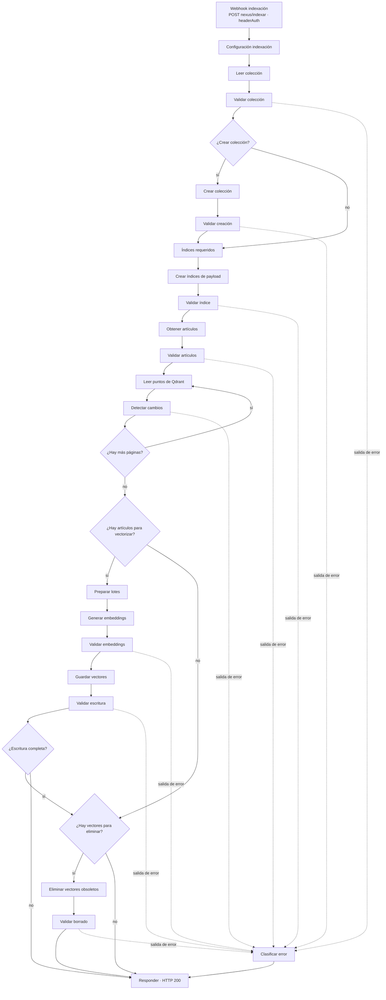
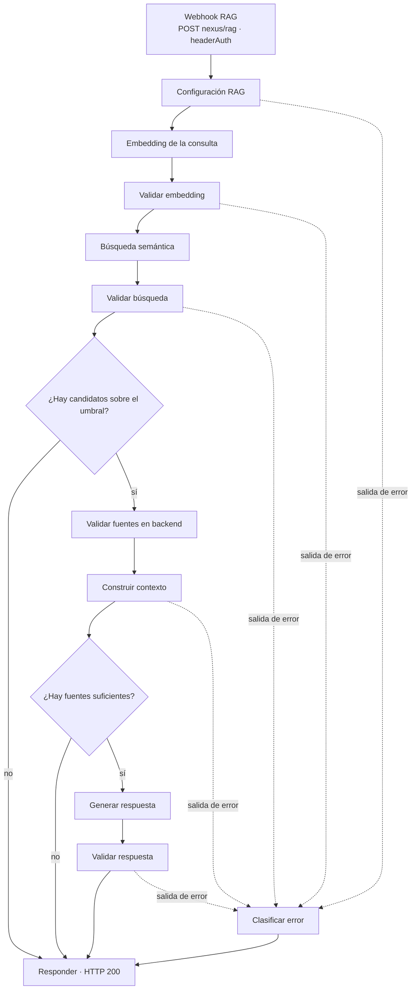

# NEXUS Support: workflows de n8n (Indexación y RAG)

Archivos:

- `n8n/workflows/nexus-indexacion.json`: Flujo 1, indexación de la base de conocimiento.
- `n8n/workflows/nexus-rag.json`: Flujo 2, asistencia inteligente RAG.
- `n8n/pruebas/pruebas-scripts.html` y `n8n/pruebas/pruebas-scripts.js`: pruebas unitarias de los scripts.

Ambos flujos existen en n8n:

- Indexación: `knTs3gLtgMBQ9sLS`
- RAG: `Eo7DZcs8CXzPNHw8`

> **Estado verificado el 2026-11-19 (lectura con el MCP de n8n):**
> - Los dos flujos están **publicados y activos**.
> - El workflow combinado `nexus-support` ya no existe en la instancia; su JSON se conserva en el repositorio como referencia.
>
> **Fuente de verdad: la versión de n8n** (decisión del usuario, etapa 2).
> - Los dos JSON del repositorio se regeneraron el 2026-11-19 a partir de la versión publicada.
> - Antes se compararon nodo por nodo: el código de **todos** los Code nodes, las expresiones HTTP, los IF, las conexiones y los ajustes eran idénticos.
> - Lo que cambió en RAG: n8n quitó las 7 notas, reacomodó los nodos y les dio ids nuevos. Los agrupó en 4 grupos visuales (`nodeGroups`): Embedding, Búsqueda en Qdrant, Fuentes verificadas y Generación.
> - Lo que cambió en Indexación: posiciones ajustadas a la cuadrícula, ids nuevos y `method: GET` implícito, que es el valor por defecto de n8n.
>
> **Etapa 4 (2026-11-20): borrador sin publicar en Indexación.**
> - Versión `4fb70e48-661a-46da-8784-4e9891b2f2b5`, guardada por MCP. La versión **publicada sigue siendo** `b504d8aa-0f5d-4382-aaf1-471d33dfc033`: producción no cambia hasta que alguien publique el borrador.
> - Cambios (4 nodos y una nota): el payload de cada vector guarda `origen` (`MANUAL` | `IMPORTACION`) e `importacion_id` (§2, punto 11).
> - `n8n/workflows/nexus-indexacion.json` contiene ya el borrador. El diff de versiones de n8n coincide con el del repositorio.
> - RAG no cambió en la etapa 4.
>
> **Etapa 5 (2026-11-20): borrador sin publicar en RAG.**
> - Versión `aa1af1b5-0450-4bd6-8f11-a6fe0b6736ff`, guardada por MCP. La versión **publicada sigue siendo** `a7545fae-faeb-4088-a76d-958067090e24`.
> - Cambian 2 nodos (*Configuración RAG* y *Construir contexto*) para el ingreso guiado (§2, punto 12).
> - `n8n/workflows/nexus-rag.json` contiene ya el borrador. El diff de versiones de n8n solo muestra esos dos nodos.
> - Qdrant no cambia en la etapa 5: no hay payload ni índice nuevo. Las alertas de SLA se calculan en PostgreSQL y no pasan por n8n.
>
> **Etapa A de §13 (2026-11-20): borradores sin publicar en los dos flujos.**
> - RAG: versión `e93a0472-d148-4b31-b952-7918b298efb6` (incluye la etapa 5). Publicada **sigue siendo** `a7545fae-…`.
> - Indexación: versión `aa063219-f025-4636-95c6-2992735127cb` (incluye la etapa 4). Publicada **sigue siendo** `b504d8aa-…`.
> - El diff de versiones de indexación (`4fb70e48` → `aa063219`) muestra solo los cambios de §2, punto 13: un nodo nuevo, un nodo renombrado, 6 nodos modificados y la nota *Etapa 1.2*.
> - Los dos JSON del repositorio contienen ya estos borradores. Ninguno se ejecutó.
>
> **Etapa B de §13 (2026-11-20): borradores sin publicar en los dos flujos.**
> - RAG: versión `e938abd6-185d-4fd9-85e8-d3c3afb8de7b` (incluye A y 5). Publicada **sigue siendo** `a7545fae-…`.
> - Indexación: versión `5596a372-7491-43b3-aaf2-e550b2e525ec` (incluye A y 4). Publicada **sigue siendo** `b504d8aa-…`.
> - Cambian *Clasificar error* (los dos flujos), *Detectar cambios* y *Validar escritura* (§2, punto 14). Los parámetros de todos los nodos en n8n son idénticos a los JSON del repositorio (comprobado tras guardar). Ninguno se ejecutó.

---

## 1. Contratos y versiones encontradas

| Componente | Versión / dato | Origen |
|---|---|---|
| Spring Boot | 3.5.7 | `backend/pom.xml` |
| Java | 21 | `backend/pom.xml` |
| n8n | 2.x (la interfaz anuncia «Get ready for n8n 3.0») | instancia |
| Nodos | webhook 2 · httpRequest 4.2 · code 2 · if 2.2 · respondToWebhook 1.1 · stickyNote 1 | versiones que acepta la instancia |
| Colección Qdrant | `articulos_conocimiento`, coseno, 1536 dimensiones | ejecución 138 |
| Embeddings | `openai/text-embedding-3-small`. OpenRouter responde `model: "text-embedding-3-small"`, sin prefijo. | ejecución 138 |

**Contrato del backend (`N8nClient`):**

- Llama a `N8N_WEBHOOK_BASE_URL` + `/nexus/indexar` y `/nexus/rag`.
- `RestClient` lanza una excepción ante cualquier respuesta que no sea 2xx. Por eso **todo resultado de negocio, incluidos los errores, vuelve con HTTP 200** y el campo `estado`.
- Envía `X-Internal-Token` en las dos llamadas, como cabecera por defecto del `RestClient` en `WebConfig.n8nRestClient()` (ver §2).
- Timeout: `RAG_TIMEOUT_SEGUNDOS` = 60.

**Datos verificados contra servicios reales** (ejecución 138 de `nexus-support`, anterior a este diseño; no la lanzaron estos flujos):

- Backend en `host.docker.internal:8080` con 29 artículos.
- Qdrant en `:6333`.
- Una colección que ya existe responde `{"status":{"error":"Wrong input: Collection ... already exists!"}}`.
- Un borrado vacío responde «Empty update request».
- Los puntos antiguos llevan `articulo_id` y `hash`, pero no `modelo`.

Endpoints internos usados (todos con `X-Internal-Token`):

- `GET /api/internal/articulos`
- `POST /api/internal/articulos/validar`

## 2. Supuestos y pendientes

1. **Autenticación de los webhooks.** Ambos webhooks exigen la cabecera `X-Internal-Token` (credencial `NEXUS - Token interno`).
   - **Aplicado (etapa 1):** el `RestClient` hacia n8n (`WebConfig.n8nRestClient()`) envía `X-Internal-Token` con el valor de `INTERNAL_API_TOKEN`, el mismo que protege `/api/internal/**`.
   - Si `INTERNAL_API_TOKEN` está vacío, no envía la cabecera y deja un aviso en el log al arrancar. El valor del token nunca se registra.
   - Dejar los webhooks sin autenticación no se acepta como solución final.
2. **Conflicto de rutas.** Resuelto: `nexus-support` ya no existe en la instancia y los nuevos flujos ocupan `nexus/indexar` y `nexus/rag`.
3. **Primera indexación completa.** Como los puntos antiguos no guardan `modelo`, la primera ejecución vuelve a vectorizar todos los artículos.
4. **Concurrencia.** Resuelto en el backend (etapa 3): `IndexacionService` ejecuta una sola indexación a la vez por instancia.
   - Las solicitudes que llegan mientras hay una en curso (botón, edición de artículos, arranque) quedan pendientes y se atienden con **una** ejecución adicional al terminar; si alguna pedía `forzar`, esa ejecución fuerza.
   - El bloqueo es en memoria: con varias instancias del backend, o llamadas directas al webhook, sigue pudiendo haber dos ejecuciones. Ambas son idempotentes (upsert por id determinista); solo duplican el coste.
5. **Reintentos.** n8n usa una espera fija entre intentos (no exponencial) y no lee `Retry-After`.
6. **Frontend.** Corregido (etapa 1): `articulos.html` lee `estado` y `etapa`. Distingue sincronización completa, `INDEXACION_PARCIAL` (nada eliminado) y error de etapa.
7. **`PENDIENTE`.** Solo lo asigna el backend al crear la consulta; n8n nunca lo devuelve.
8. **Datos del backend.** Se asume que `/api/internal/articulos` devuelve solo artículos activos y verificados, y que el flujo los filtra de nuevo con `fuente_valida`.
9. **Timeout de la indexación.** Resuelto (etapa 3): la indexación usa su propio `RestClient` con `N8N_INDEXACION_TIMEOUT_SEGUNDOS` (1860 s por defecto, por encima del `executionTimeout` de 1800 s). El RAG conserva `RAG_TIMEOUT_SEGUNDOS` (60 s).
   - `POST /api/articulos/reindexar` ya no espera a n8n: responde **202** con el estado, y `articulos.html` consulta `GET /api/articulos/indexacion` cada 3 s.
   - Estados: `NUNCA`, `EN_CURSO`, `FINALIZADA` (el resultado de n8n va en `resultado`, con su propio `estado`/`etapa`), `SIN_CONEXION`, `ERROR`. El estado vive en memoria y se pierde al reiniciar.
10. **Fuentes usadas y candidatas.** Resuelto en el backend sin tocar n8n (etapa 3): además de `fuentes` (citadas), el backend lee `auditoria.candidatas` de las respuestas `RESPONDIDA`.
   - Las candidatas con `citada: false`, si siguen activas y verificadas, se guardan en `fuente_respuesta` con `usada = false`. Las citadas, con `usada = true`.
   - Solo las citadas cuentan como evidencia: la analítica de uso de artículos filtra `fr.usada` y la revisión posterior cuenta solo las usadas. La interfaz muestra las candidatas aparte, plegadas.
   - En `SIN_RESULTADOS` no se guardan candidatas.
11. **Origen de los artículos en Qdrant (etapa 4, borrador).** `/api/internal/articulos` envía además `origen` (`MANUAL` o `IMPORTACION`) e `importacionId` (id de la importación de archivo, o `null`).
   - *Validar artículos* los acepta como opcionales: un backend anterior no los envía y se asume `MANUAL`. Rechaza valores desconocidos y un `importacionId` sin `origen: IMPORTACION`.
   - *Leer puntos de Qdrant* lee también `origen` e `importacion_id`, y *Detectar cambios* reescribe un punto si alguno no coincide. **Consecuencia:** la primera ejecución tras publicar vuelve a vectorizar todos los artículos válidos una vez, porque los puntos actuales no tienen `origen`.
   - *Validar embeddings* los guarda en el payload. No forman parte del texto vectorizado ni del hash.
   - Compatibilidad: el flujo publicado (sin estos cambios) sigue funcionando con el backend nuevo, porque ignora los campos extra.
   - Los borradores importados nacen inactivos y sin verificar, así que el flujo no los vectoriza hasta que alguien los active y verifique. La carga de archivos no usa n8n y no hay un tercer workflow.
12. **Ingreso guiado en la consulta RAG (etapa 5, borrador).** `incidente` admite además `elemento` (≤ 300), `mensajeError` (≤ 1000) y `pasosIntentados` (≤ 2000). Son opcionales y siguen rechazándose las demás claves.
   - **Búsqueda:** el texto que se vectoriza es título + elemento + pregunta + mensaje de error. Los pasos intentados quedan fuera, porque describen lo que no funcionó y no el problema.
   - **Generación:** el bloque `<incidente>` incluye `elemento_afectado`, `mensaje_error` y `pasos_ya_intentados`, también como datos no confiables. Hay dos reglas nuevas en el prompt: no proponer de nuevo los pasos ya intentados (o escalar si son los únicos documentados), y usar el mensaje de error y el elemento como pistas sin descartar un documento porque no contenga el mensaje literal.
   - **Compatibilidad:** el flujo publicado rechaza esas claves (`VALIDACION`). Por eso el backend solo las envía con `RAG_INGRESO_GUIADO_ESTRUCTURADO=true`, que debe activarse **después** de publicar este borrador. Con `false` (por defecto), el backend agrega esos datos al texto de `pregunta` y funciona con cualquier versión. Además, `IncidenteRag` omite los campos nulos.
   - Con `true`, la pregunta por defecto es solo la descripción, para no duplicar los datos guiados.
13. **Trazabilidad y esquema de Qdrant (etapa A de §13, borradores).** Inspección previa: Qdrant 1.20.0, colección `articulos_conocimiento` (1536, Cosine, 27 puntos), índice de payload solo en `fuente_valida`, sin alias ni snapshots. Ningún punto tiene `modelo`.
   - **Filtro antes de recuperar.** *Búsqueda semántica* filtra en Qdrant por `fuente_valida = true` **y** `modelo = NEXUS_EMBEDDING_MODEL`. Así nunca se mezclan vectores de otro modelo, y *Validar búsqueda* conserva la comprobación solo como defensa ante un payload inesperado.
   - **Consecuencia operativa:** como los 27 puntos actuales no tienen `modelo`, el RAG publicado con este borrador **no encuentra nada hasta que se ejecute una indexación** con el borrador de indexación (que los reescribe con `modelo`). Orden: publicar indexación → indexar → publicar RAG.
   - **Índices de payload solo en campos filtrados.** *Índices requeridos* emite `fuente_valida` (bool) y `modelo` (keyword); *Crear índices de payload* hace un `PUT /index` por ítem (idempotente) y *Validar índice* comprueba cada respuesta. *Validar colección* rechaza un índice `modelo` de otro tipo. `articulo_id` no se indexa porque es el id del punto; `categoria` no se filtra.
   - **Esquema del payload:** `articulo_id`, `titulo`, `categoria`, `hash`, `modelo`, `dimension`, `fuente_valida`, `indexado_en`, `origen`, `importacion_id` y el nuevo `version_articulo` (la `fechaActualizacion` del artículo en Spring Boot, validada como ISO si viene). `version_articulo` es informativo: el cambio de contenido lo sigue detectando `hash`, por lo que no fuerza revectorizaciones.
   - **correlationId.** El backend genera un UUID por consulta RAG y por indexación y lo envía en la cabecera `X-Correlation-Id` (no en el cuerpo: los flujos publicados rechazan claves desconocidas). Los dos *Responder* devuelven `correlationId` (solo si cumple `[A-Za-z0-9._-]{1,64}`; si no, `null`) y `ejecucionId` (`$execution.id`).
   - **Persistencia en el backend:** `consulta_ia.correlacion_id` y `consulta_ia.n8n_ejecucion_id` (`05-mejoras.sql`). El id de ejecución solo se guarda si cumple el mismo patrón. Con el flujo publicado actual llega `null`.
   - **Registro:** `N8nClient` registra correlationId, ejecución, consulta, estado, etapa, número de fuentes y duración (RAG) o estado, etapa, resumen y duración (indexación). Nunca registra el texto del incidente, la respuesta ni el token, y avisa si el correlationId devuelto no coincide.
   - **Inspeccionar una ejecución (y reintentarla):** buscar la consulta en `consulta_ia` (`correlacion_id` o `n8n_ejecucion_id`) y abrir en n8n *Executions* la ejecución con ese id. El log de ejecuciones de n8n es una ayuda de diagnóstico y puede purgarse; la persistencia de negocio sigue siendo PostgreSQL.
14. **Resultado por artículo, errores tipados y reintentos (etapa B de §13, borradores).**
   - **Resultado por artículo.** La respuesta de indexación incluye `articulos: [{ id, resultado, motivo, tipoError?, detalle? }]` con `resultado` ∈ `PROCESADO` | `OMITIDO` | `FALLIDO` y `motivo` de una lista fija: `VECTORIZADO`, `SIN_CAMBIOS`, `NO_ES_FUENTE_VALIDA`, `EMBEDDINGS_FALLIDOS`, `ESCRITURA_FALLIDA`, `ESCRITURA_NO_CONFIRMADA`. `detalle` (≤ 200) es el mensaje del lote, enmascarado y sin texto de artículos.
   - Lo que se va a vectorizar nace `FALLIDO / ESCRITURA_NO_CONFIRMADA` en *Detectar cambios* y solo *Validar escritura* lo pasa a `PROCESADO` tras confirmar `status: completed` en Qdrant. Un fallo posterior (por ejemplo, al borrar obsoletos) conserva en *Clasificar error* el último resultado por artículo conocido.
   - **Errores consistentes.** Toda respuesta `ERROR` de los dos flujos lleva `tipoError` ∈ `AUTENTICACION`, `VALIDACION`, `SERVICIO_NO_DISPONIBLE`, `TIMEOUT`, `INTERNO` y `reintentable` (solo `SERVICIO_NO_DISPONIBLE` y `TIMEOUT`). `VALIDACION` agrupa las etapas `VALIDACION`, `CONFIGURACION` y `CONTENIDO`; las violaciones de contrato (`*_CONTRATO`) son `INTERNO`. La clasificación se basa en la etapa y en patrones del mensaje (códigos HTTP, `ECONNREFUSED`, `timeout`…): es heurística y está pendiente de verificarse con ejecuciones reales.
   - Fuera del flujo quedan dos casos: un token incorrecto lo rechaza n8n con HTTP 403 antes de ejecutar, y un `executionTimeout` o un fallo no capturado devuelve un error HTTP. El backend trata ambos como `SIN_CONEXION` (`N8nException`).
   - **Una sola respuesta.** Comprobado sobre los JSON: cada salida de cada nodo tiene un único destino y *Responder* no tiene salidas, así que cada camino llega una vez a *Responder*.
   - **Reintentos en n8n.** La instancia solo admite espera fija (`maxTries` 2–5, `waitBetweenTries` ≤ 5000 ms), sin backoff ni `Retry-After`. Se mantienen en los nodos idempotentes (lecturas, índices, upsert, borrado, embeddings) y no en los que no lo son (*Crear colección*, *Generar respuesta*).
   - **Reintento con backoff en el backend.** `IndexacionService` repite una indexación cuyo resultado sea `ERROR` con `reintentable: true` (o, con el flujo publicado que no envía `reintentable`, `INDEXACION_PARCIAL`), hasta `INDEXACION_REINTENTOS` (2; máximo 5) veces, esperando `INDEXACION_ESPERA_REINTENTO_SEGUNDOS` (30) y el doble en cada intento (tope de 10 min). El reintento **nunca usa `forzar`**: por el hash, los artículos ya indexados quedan `OMITIDO / SIN_CAMBIOS` y solo se vuelven a vectorizar los fallidos. No se reintenta `SIN_CONEXION` (incluido el timeout del backend), porque la ejecución anterior podría seguir viva en n8n. El RAG no se reintenta: es interactivo y la generación no es idempotente.
   - **Reintentar a mano.** Basta con *Sincronizar embeddings* (sin forzar): por el mismo motivo, solo se procesan los artículos que fallaron. Reintentar una ejecución desde *Executions* de n8n también es seguro (upsert por id y borrado solo tras confirmar), pero no actualiza el estado que ve el backend.

## 3. Diagramas

### Flujo 1: Indexación



### Flujo 2: RAG



## 4. Tabla de nodos

Cada etapa es un **HTTP** seguido de un **script de organización/validación**:

- Los Code nodes no contienen `if`, `else` ni ternarios. Las validaciones lanzan error mediante `exigir()`.
- Las bifurcaciones solo se hacen en nodos IF.
- Los nodos HTTP tienen `continueErrorOutput`, de modo que sus fallos los recoge el script de validación que sigue.

### Indexación (timeout de ejecución: 1800 s)

| Nodo | Tipo | Función | Reintentos / timeout |
|---|---|---|---|
| Webhook indexación | webhook | `POST nexus/indexar`, headerAuth, respuesta vía nodo | — |
| Configuración indexación | code | Valida `forzar` y lee las `NEXUS_*` | — |
| Leer colección | http GET | `GET /collections/{c}` | 3× / 1 s · 10 s |
| Validar colección | code | Comprueba que exista, la dimensión, la métrica coseno y el tipo de los índices `fuente_valida` y `modelo` | — |
| ¿Crear colección? | if | Crear solo si no existe | — |
| Crear colección | http PUT | Crea la colección (no idempotente: sin reintento) | 0 · 15 s |
| Validar creación | code | Acepta «already exists» como conflicto benigno | — |
| Índices requeridos | code | Un ítem por índice: `fuente_valida` (bool), `modelo` (keyword) | — |
| Crear índices de payload | http PUT | Un índice de payload por ítem (idempotente) | 3× / 1 s · 15 s |
| Validar índice | code | Comprueba cada respuesta | — |
| Obtener artículos | http GET | `/api/internal/articulos` | 3× / 1 s · 15 s |
| Validar artículos | code | Contrato, `fuente_valida`, hash del contenido, `origen`, `importacionId` y `fechaActualizacion` opcionales | — |
| Leer puntos de Qdrant | http POST | `points/scroll` paginado | 3× / 1 s · 15 s |
| Detectar cambios | code | Compara hash, modelo y origen, calcula obsoletos, acumula páginas y arma el resultado inicial por artículo | — |
| ¿Hay más páginas? | if | Vuelve al scroll mientras haya `next_page_offset` | — |
| ¿Hay artículos para vectorizar? | if | — | — |
| Preparar lotes | code | Lotes de `NEXUS_EMBEDDING_LOTE` | — |
| Generar embeddings | http POST | `/embeddings`, `batchInterval` de 250 ms | 2× / 2 s · 30 s |
| Validar embeddings | code | Modelo (sin prefijo), dimensión, valores finitos, orden; arma el payload con `version_articulo` | — |
| Guardar vectores | http PUT | Upsert `points?wait=true` (idempotente) | 3× / 2 s · 60 s |
| Validar escritura | code | Cuenta lotes correctos y fallidos; resultado por artículo, `tipoError` y `reintentable` | — |
| ¿Escritura completa? | if | Si algo falló: `ERROR/INDEXACION_PARCIAL` y no se borra nada | — |
| ¿Hay vectores para eliminar? | if | — | — |
| Eliminar vectores obsoletos | http POST | `points/delete?wait=true` (idempotente) | 3× / 1 s · 30 s |
| Validar borrado | code | Arma la respuesta final `OK/COMPLETADA` | — |
| Clasificar error | code | Etapa a partir del prefijo `[ETAPA]`, `tipoError`, mensaje enmascarado, último resultado por artículo | — |
| Responder | respondToWebhook | Única respuesta, HTTP 200, con `correlationId` y `ejecucionId` | — |

### RAG (timeout de ejecución: 58 s; presupuesto ≈ 57 s, menor que los 60 s del backend)

| Nodo | Tipo | Función | Reintentos / timeout |
|---|---|---|---|
| Webhook RAG | webhook | `POST nexus/rag`, headerAuth | — |
| Configuración RAG | code | Valida `RagSolicitud`: rechaza campos desconocidos, pregunta ≥ 3 caracteres, `topK` 3–5, umbral, ingreso guiado opcional; arma el texto de búsqueda | — |
| Embedding de la consulta | http POST | `/embeddings`. Con `simularFalloEmbeddings`, usa un host `.invalid`. | 2× / 0,5 s · 7 s |
| Validar embedding | code | Modelo, dimensión, valores finitos | — |
| Búsqueda semántica | http POST | `points/query`, filtro `fuente_valida` y `modelo` en Qdrant | 2× / 0,5 s · 4 s |
| Validar búsqueda | code | Aplica el umbral de coseno sin recorte y calcula `mejorSimilitud` | — |
| ¿Hay candidatos sobre el umbral? | if | Si no hay: `SIN_RESULTADOS/BUSQUEDA` | — |
| Validar fuentes en backend | http POST | `/api/internal/articulos/validar` | 2× / 0,5 s · 4 s |
| Construir contexto | code | Fuentes vigentes, documentos e incidente (con ingreso guiado) delimitados como datos, `minResultados` | — |
| ¿Hay fuentes suficientes? | if | Si no hay: `SIN_RESULTADOS/FUENTES` | — |
| Generar respuesta | http POST | `/chat/completions` (no idempotente: sin reintento) | 0 · 25 s |
| Validar respuesta | code | JSON `{respuesta, pasos, fuentesUsadas}`; devuelve solo las fuentes citadas | — |
| Clasificar error | code | `ERROR` con la forma de `RagResultado`, más `tipoError` y `reintentable` | — |
| Responder | respondToWebhook | Única respuesta, HTTP 200, con `correlationId` y `ejecucionId` | — |

## 5. Contratos JSON de los webhooks

Cabecera obligatoria en ambos: `X-Internal-Token: <valor de INTERNAL_API_TOKEN>`.

Cabecera opcional en ambos (borradores de la etapa A): `X-Correlation-Id`. Toda respuesta de esos borradores, éxito o error, añade `"correlationId": "<eco o null>"` y `"ejecucionId": "<id de ejecución de n8n>"`.

Respuestas HTTP:

| Caso | Código |
|---|---|
| Cualquier resultado de negocio, errores incluidos | 200, con `estado` |
| Token ausente o incorrecto | 403, generado por n8n antes de ejecutar el flujo (no es un `estado`) |
| Flujo inactivo | 404 |

### Indexación

Entrada (cuerpo opcional; los campos desconocidos se rechazan):

```json
{ "forzar": false }
```

Éxito:

```json
{
  "estado": "OK", "etapa": "COMPLETADA", "mensaje": "Indexación completada",
  "resumen": { "leidos": 29, "fuentesValidas": 29, "excluidos": 0, "actualizados": 2,
               "omitidos": 27, "eliminados": 1, "fallidos": 0 },
  "vectorizados": [12, 15], "eliminados": [40], "fallidos": [], "detalleFallos": [],
  "sinCambios": 27, "totalArticulos": 29, "coleccion": "articulos_conocimiento",
  "modeloEmbeddings": "openai/text-embedding-3-small", "dimension": 1536,
  "forzar": false, "configuracion": { "loteEmbeddings": 32, "loteScroll": 256 }
}
```

Fallo parcial (se escribieron los lotes válidos, no se borró nada):

```json
{ "estado": "ERROR", "etapa": "INDEXACION_PARCIAL",
  "mensaje": "[QDRANT] 1 de 2 lotes no se pudieron guardar",
  "vectorizados": [12], "eliminados": [], "fallidos": [15], "detalleFallos": ["..."] }
```

Con los borradores de la etapa B, el mismo fallo parcial añade el tipo y el resultado por artículo:

```json
{ "estado": "ERROR", "etapa": "INDEXACION_PARCIAL", "tipoError": "SERVICIO_NO_DISPONIBLE", "reintentable": true,
  "articulos": [ { "id": 12, "resultado": "PROCESADO", "motivo": "VECTORIZADO" },
                 { "id": 15, "resultado": "FALLIDO", "motivo": "ESCRITURA_FALLIDA",
                   "tipoError": "SERVICIO_NO_DISPONIBLE", "detalle": "[QDRANT] HTTP 503 ..." },
                 { "id": 20, "resultado": "OMITIDO", "motivo": "SIN_CAMBIOS" } ] }
```

Error de etapa:

```json
{ "estado": "ERROR", "etapa": "EMBEDDINGS",
  "mensaje": "[EMBEDDINGS] HTTP 401 ... (sk-or…/Bearer… enmascarados)",
  "vectorizados": [], "eliminados": [], "sinCambios": 0 }
```

### RAG

Entrada (`RagSolicitud`):

```json
{
  "consultaId": 101,
  "pregunta": "No puedo conectarme a la VPN",
  "incidente": { "titulo": "VPN caída", "categoria": "Redes", "prioridad": "ALTA" },
  "umbral": 0.45, "topK": 5, "minResultados": 1, "simularFalloEmbeddings": false
}
```

`RESPONDIDA`:

```json
{
  "consultaId": 101, "estado": "RESPONDIDA", "etapa": "COMPLETADA", "mensaje": "Respuesta generada",
  "respuesta": "…", "pasos": ["…", "…"],
  "fuentes": [{ "articuloId": 7, "titulo": "Reinicio de VPN", "categoria": "Redes",
                "similitud": 0.71, "usada": true }],
  "mejorSimilitud": 0.71, "modelo": "openai/gpt-4o-mini",
  "generadoEn": "2026-11-19T10:00:00.000Z", "auditoria": { "candidatos": 3, "vigentes": 2 }
}
```

`SIN_RESULTADOS`:

```json
{ "consultaId": 101, "estado": "SIN_RESULTADOS", "etapa": "BUSQUEDA",
  "mensaje": "Ningún artículo supera el umbral 0.45", "respuesta": null, "pasos": [],
  "fuentes": [], "mejorSimilitud": 0.31, "modelo": null }
```

La etapa también puede ser `FUENTES`, cuando los candidatos ya no están vigentes o no llegan a `minResultados`.

`ERROR`:

```json
{ "consultaId": 101, "estado": "ERROR", "etapa": "EMBEDDINGS",
  "mensaje": "[EMBEDDINGS] fallo simulado / HTTP …", "respuesta": null, "pasos": [],
  "fuentes": [], "mejorSimilitud": null, "modelo": null }
```

Etapas de error posibles en RAG:

- CONFIGURACION
- VALIDACION
- EMBEDDINGS
- QDRANT
- VALIDACION_FUENTES
- GENERACION

Las que terminan en `_CONTRATO` indican una respuesta del servicio con forma inesperada.

## 6. JSON completos

- [`n8n/workflows/nexus-indexacion.json`](../../n8n/workflows/nexus-indexacion.json): 33 nodos, 26 funcionales y 7 notas.
- [`n8n/workflows/nexus-rag.json`](../../n8n/workflows/nexus-rag.json): 14 nodos funcionales, sin notas (se quitaron en n8n), con los 4 grupos visuales de n8n en `nodeGroups`. Son solo visuales: una versión de n8n que no los soporte los ignora al importar. Las etapas 2.1 a 2.6 están descritas en §3 y §4 de este documento.

Están listos para importar:

- No incluyen `id`, `meta`, `active` ni `pinData`.
- Las credenciales van solo como referencias (`NEXUS - Token interno`, `OpenRouter account`), sin valores secretos.
- El generador comprobó que no aparecen `if`, `else` ni ternarios en ningún Code node.

## 7. Matriz de pruebas

| Tipo | Qué cubre | Estado |
|---|---|---|
| **Unitarias** | Los scripts de los Code nodes, ejecutados de forma aislada con entradas simuladas en `n8n/pruebas/pruebas-scripts.html`. Cubren configuración, validación de contratos, umbral, paginación, lotes, fallos parciales, enmascarado de secretos, ausencia de `if`/ternarios y forma de las respuestas. | **Ejecutadas: 124/124 correctas** (sirviendo `n8n/` por HTTP, p. ej. con `jwebserver`) |
| **Integración simulada** | Ejecutar los workflows en n8n con `pinData` o servicios simulados | **No realizada** |
| **Reales** | Backend + Qdrant + OpenRouter auténticos | **No ejecutadas** (requieren autorización explícita) |

Casos reales recomendados antes de activar:

| # | Caso | Resultado esperado |
|---|---|---|
| R1 | Indexar con la colección existente | `OK`; la primera vez, todos los artículos en `vectorizados` |
| R2 | Indexar de nuevo sin cambios | `OK`, `sinCambios` = total, `vectorizados` = [] |
| R3 | Editar un artículo y reindexar | Solo ese id en `vectorizados` |
| R4 | Desactivar un artículo y reindexar | Su id en `eliminados` |
| R5 | Credencial de OpenRouter inválida | `ERROR/EMBEDDINGS`, mensaje sin secretos, nada borrado |
| R6 | Consulta RAG relevante | `RESPONDIDA` con solo las fuentes citadas |
| R7 | Pregunta sin relación con la base | `SIN_RESULTADOS/BUSQUEDA` |
| R8 | `simularFalloEmbeddings: true` (con `RAG_PERMITIR_SIMULACION_FALLOS`) | `ERROR/EMBEDDINGS` |
| R9 | Llamada sin `X-Internal-Token` | 403 de n8n, sin ejecución |
| R10 | Qdrant detenido | `ERROR/QDRANT` en menos de 60 s |

## 8. Variables de entorno y credenciales

Variables de n8n (ninguna es secreta; todas tienen un valor por defecto en el nodo de configuración):

| Variable | Por defecto | Flujo |
|---|---|---|
| `NEXUS_BACKEND_URL` | `http://host.docker.internal:8080` | ambos |
| `NEXUS_QDRANT_URL` | `http://host.docker.internal:6333` | ambos |
| `NEXUS_QDRANT_COLLECTION` | `articulos_conocimiento` | ambos |
| `NEXUS_OPENROUTER_BASE_URL` | `https://openrouter.ai/api/v1` | ambos |
| `NEXUS_EMBEDDING_MODEL` | `openai/text-embedding-3-small` | ambos |
| `NEXUS_EMBEDDING_DIMENSION` | `1536` | ambos |
| `NEXUS_EMBEDDING_LOTE` | `32` | indexación |
| `NEXUS_QDRANT_SCROLL_LOTE` | `256` | indexación |
| `NEXUS_QDRANT_MAX_PAGINAS` | `200` | indexación |
| `NEXUS_MAX_CARACTERES_ARTICULO` | `20000` | indexación |
| `NEXUS_CHAT_MODEL` | `openai/gpt-4o-mini` | RAG |
| `NEXUS_MAX_CARACTERES_PREGUNTA` | `5000` | RAG |
| `NEXUS_MAX_CARACTERES_DOCUMENTO` | `6000` | RAG |
| `NEXUS_TOPK_MIN` / `NEXUS_TOPK_MAX` | `3` / `5` | RAG |

Para que los nodos puedan leer `$env`, n8n debe tener `N8N_BLOCK_ENV_ACCESS_IN_NODE=false`. Si no, se usan los valores por defecto.

Credenciales de n8n:

| Credencial | Tipo | Uso |
|---|---|---|
| `NEXUS - Token interno` | Header Auth (`X-Internal-Token`) | Autenticación de los dos webhooks y de las llamadas a `/api/internal/**` |
| `OpenRouter account` | OpenRouter API | Embeddings y chat |

Variables del backend relacionadas:

- `N8N_WEBHOOK_BASE_URL`
- `INTERNAL_API_TOKEN`: debe coincidir con la credencial `NEXUS - Token interno`.
- `RAG_UMBRAL_SIMILITUD` (0.45), `RAG_TOP_K` (5), `RAG_MIN_RESULTADOS` (1)
- `RAG_TIMEOUT_SEGUNDOS` (60)
- `N8N_INDEXACION_TIMEOUT_SEGUNDOS` (1860): espera máxima de una indexación; debe superar el `executionTimeout` del flujo (1800 s).
- `RAG_PERMITIR_SIMULACION_FALLOS`

## 9. Guía de importación, revisión y activación

1. **Importar.** En n8n, ir a *Workflows → Import from file* y elegir cada JSON. En esta instancia ya están creados como borradores (ver la cabecera del documento).
2. **Credenciales.** Abrir cada nodo HTTP y los dos webhooks y confirmar que aparecen `NEXUS - Token interno` y `OpenRouter account`. Si la importación se hace en otra instancia, volver a asignarlas.
3. **Revisar:**
   - las rutas de los webhooks;
   - la configuración (`executionTimeout` 1800 y 58; guardar solo las ejecuciones con error);
   - las variables `NEXUS_*`.
4. **Backend.** Confirmar que `INTERNAL_API_TOKEN` del `.env` coincide con la credencial `NEXUS - Token interno` de n8n, y reiniciar Spring Boot. La cabecera ya se envía (§2.1).
5. **Pruebas.** Probar con la URL `webhook-test` desde el editor, usando primero datos de prueba. Después, los casos R1–R10 con autorización.
6. **Cambio de flujo:**
   1. Desactivar `nexus-support`.
   2. Publicar o activar `NEXUS – Flujo 1 – Indexación…` y `NEXUS – Flujo 2 – Asistencia inteligente RAG`.
   3. Lanzar una reindexación desde el frontend y comprobar el resultado R1.
7. **Marcha atrás.** Desactivar los dos nuevos y reactivar `nexus-support`. Los datos de Qdrant siguen siendo compatibles, porque se usan el mismo id de punto y el mismo payload.

## 10. Decisiones y limitaciones

**Respuestas y errores:**

- Siempre HTTP 200 con `estado`, porque `RestClient` del backend lanza una excepción con cualquier código que no sea 2xx.
- Exactamente un `Responder` por flujo, alcanzable desde todas las ramas.
- Los errores llevan el prefijo `[ETAPA]`, del que sale `etapa`.
- Antes de responder se enmascaran claves `sk-or-…`, `Bearer …` y valores de `X-Internal-Token`.

**Reintentos:**

- Solo en operaciones idempotentes: lecturas, upsert con id determinista, borrado por ids, índice y embeddings.
- Sin reintento en la creación de la colección (el conflicto se trata como benigno) ni en la generación del chat (coste y no determinismo).

**Seguridad de los datos al indexar:**

- El borrado de obsoletos solo se ejecuta tras un scroll completo y la confirmación de todas las escrituras.
- Si hay un fallo parcial, se conservan los vectores existentes.

**Modelo de embeddings:**

- Se compara sin el prefijo de proveedor (OpenRouter responde sin `openai/`).
- Cambiar de modelo fuerza la revectorización, porque el payload guarda `modelo`.

**Búsqueda RAG:**

- El umbral de coseno se aplica sin recortar las puntuaciones.
- Se devuelven al backend solo las fuentes citadas, porque el backend persiste todas las que recibe con `similitud`.
- Los documentos se delimitan como datos para mitigar inyección de instrucciones. Es una mitigación, no una garantía.

**Limitaciones:**

- Control de concurrencia solo dentro de una instancia del backend (bloqueo en memoria).
- Espera fija entre reintentos.
- `executionTimeout` de RAG ajustado a 58 s: con latencias altas puede cortar antes que el backend.
- No hay pruebas de integración simuladas ni reales todavía.
- No se creó un tercer workflow de analítica, por diseño.
